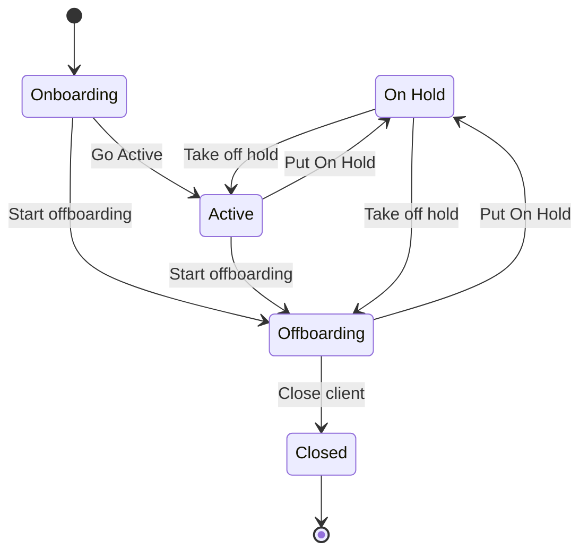

## In short

Every client has one [Client Status](term:client-status): Onboarding, Active, On Hold, Offboarding or Closed. You change it from **Client Status** on the client's page, and each change is kept under **History**.

## What each status means {#statuses}

| Client Status | What it means |
| --- | --- |
| Onboarding | The [client](term:client) is being set up. Every new client starts here. |
| Active | The client is set up and ready. |
| On Hold | Your team has paused the client, with a reason and a message for the client. |
| Offboarding | The client is leaving, and has a last booking date. |
| Closed | The client has left. It is kept, but nothing about it can be changed. |

The status shows at the top of the client's page and in the **Clients** list. To list the clients with one status, open the filters on **Clients** and choose it under **Client Status**.

## Which status can follow which {#moves}

**Client Status** on the client's page offers only the changes its status allows. Nothing leads back to Onboarding, and an Offboarding client can't go back to Active.

An Admin, an [Account Manager](term:account-manager) or a [Finance Manager](term:finance-manager) can change a Client Status.

## Onboarding to Active {#active}

An Onboarding client's page lists what it still needs to go Active. When everything is there, select **Client Status**, then **Go Active**. For the list, see [the checklist](article:set-up-a-client#checklist).

## On Hold {#on-hold}

Select **Client Status**, then **Put On Hold**. You enter two things, and both are needed:

- **Reason (your team only)** says why. Only your team sees it.
- **Message for the client** says what the client is told, in plain words.

At Trentside Logistics, Mark Okafor puts Sherwood Print Works On Hold. His reason is "Two invoices overdue, £412 owed." His message for the client is "Call us about your collections."

Both show on the client's page while it is On Hold. To end the hold, select **Client Status**, then **Take off hold**. The client goes back to the status it had before: Active or Offboarding.

An Onboarding client can't be put On Hold.

## Offboarding {#offboarding}

Use it when a client is leaving. Select **Client Status**, then **Start offboarding**, and choose the **Last booking date**: today or a later date. The date shows on the client's page.

Offboarding can't be undone. If you start it while the client is On Hold, the client stays On Hold. It becomes Offboarding when you take it off hold.

## Closed {#closed}

Only an Offboarding client can be Closed. Select **Client Status**, then **Close client**.

Closed is final. You can still open the client and read its contacts, Collection Addresses, settings and history. You can't change any of them, and you can't open the client again. The one thing an Admin or Account Manager can still change is its Account Manager.

A client is never deleted.
