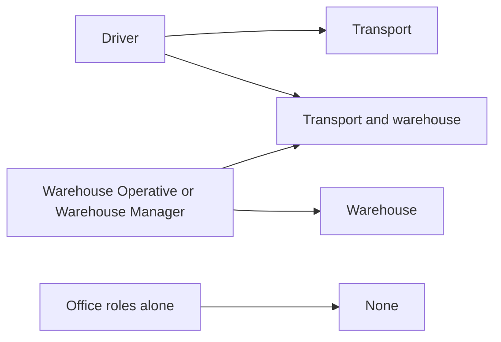

## In short

Each person at your business holds one or more [Staff Roles](term:staff-role), which decide what they can see and change. A person with several roles can do everything each of them allows. Their roles also give them their [Worker Type](term:worker-type).

## The seven Staff Roles {#roles}

Every role reaches all of your business's clients, vehicles and routes. Cover for a colleague on holiday works without changes.

| Staff Role | What it is for | Who gives it |
| --- | --- | --- |
| Admin | Every power, including giving the office roles and Admin. | An Admin |
| Finance Manager | Your business's money: collection charges and, later, invoices. | An Admin |
| Account Manager | Looks after clients: their details, contacts, schedules, queries and failures. | An Admin |
| Transport Manager | Keeps vehicles, organises routes and watches progress. | An Admin |
| Driver | Drives collection rounds and records proof of collection and failures. | An Admin or a Transport Manager |
| Warehouse Manager | Everything a Warehouse Operative does, plus check-in exceptions. | An Admin |
| Warehouse Operative | Checks in collected goods. | An Admin or a Warehouse Manager |

The person who set up your business is always an Admin, and nobody can take that away. Menus show only the screens a person's roles let them use.

## Several roles at once {#several-roles}

Give a person every role they need, rather than a second Sign-in. At Trentside Logistics, Lee Marsh drives a round in the morning and checks in collected goods after lunch. He is both a Driver and a Warehouse Operative.

## Worker Type {#worker-type}

First Mile Manager works out each person's Worker Type from their roles, and shows it beside their roles in **People**. You never choose it.

- Driver gives Transport.
- Warehouse Operative or Warehouse Manager gives Warehouse.
- Both together give Transport and warehouse, as Lee has.
- Admin, Finance Manager, Account Manager and Transport Manager alone give none, so office staff aren't put on a shift rota.

